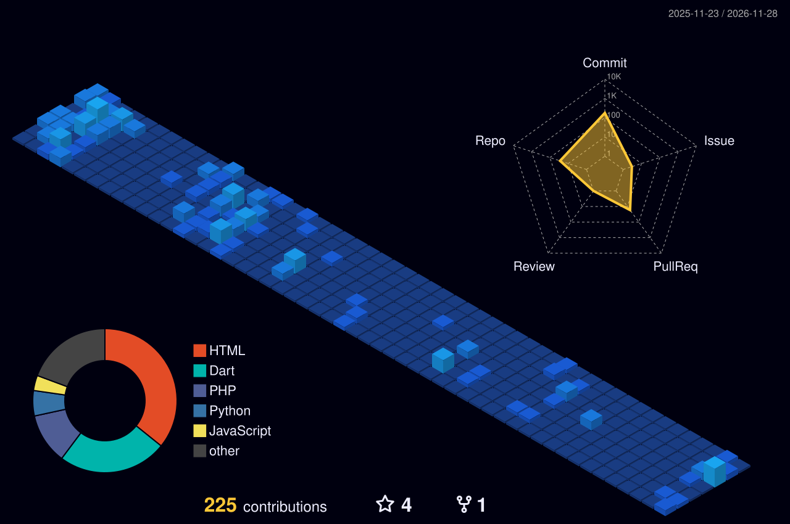

<picture>
  <source media="(prefers-color-scheme: dark)" srcset="assets/terminal-dark.svg" />
  <source media="(prefers-color-scheme: light)" srcset="assets/terminal-light.svg" />
  
</picture>

  

&nbsp;

&nbsp;

---

<h2> About Me</h2>

I'm **Aldren Louie Reyes** (`Sancho-Soft`), a full-stack developer based in the **Philippines** who builds operating systems on the side. I write web and mobile applications with **Laravel** and **Flutter**, and bare-metal **x86-64** code in **C**, **Assembly**, and **UEFI**, backed by hands-on experience in hardware diagnostics, routing, and systems hardening.

Currently finishing my capstone **CapaciPrint**, developing **OqelixOS** (UEFI kernel & Linux distribution), and building an interactive **3D Portfolio Website**.

 

---

<h2> Tech Stack</h2>

<h3> Languages &amp; Bare Metal</h3>

  <picture>
    <source media="(prefers-color-scheme: dark)" srcset="https://skillicons.dev/icons?i=c%2Ccpp%2Ccs%2Cjava%2Cpy%2Cjs%2Cphp%2Cdart%2Cr%2Crust%2Csolidity%2Chtml%2Ccss%2Cpowershell&perline=14&theme=dark" />
    <source media="(prefers-color-scheme: light)" srcset="https://skillicons.dev/icons?i=c%2Ccpp%2Ccs%2Cjava%2Cpy%2Cjs%2Cphp%2Cdart%2Cr%2Crust%2Csolidity%2Chtml%2Ccss%2Cpowershell&perline=14&theme=light" />
    
  </picture>

<h3> Frameworks, Libraries &amp; Tools</h3>

  <picture>
    <source media="(prefers-color-scheme: dark)" srcset="https://skillicons.dev/icons?i=laravel%2Cdotnet%2Cflutter%2Ctailwind%2Cnodejs%2Cexpress%2Cfastapi%2Cnextjs%2Cnestjs%2Cvite%2Cnpm%2Cunity%2Cpostman%2Cdocker%2Carduino%2Cgit%2Cgithub%2Cvscode%2Cvim%2Cpr%2Cps%2Cae&perline=11&theme=dark" />
    <source media="(prefers-color-scheme: light)" srcset="https://skillicons.dev/icons?i=laravel%2Cdotnet%2Cflutter%2Ctailwind%2Cnodejs%2Cexpress%2Cfastapi%2Cnextjs%2Cnestjs%2Cvite%2Cnpm%2Cunity%2Cpostman%2Cdocker%2Carduino%2Cgit%2Cgithub%2Cvscode%2Cvim%2Cpr%2Cps%2Cae&perline=11&theme=light" />
    
  </picture>

<h3> Cloud, Databases &amp; Platforms</h3>

  <picture>
    <source media="(prefers-color-scheme: dark)" srcset="https://skillicons.dev/icons?i=aws%2Cgcp%2Ccloudflare%2Cvercel%2Cfirebase%2Csupabase%2Cpostgres%2Cmysql%2Csqlite%2Clinux%2Cbash%2Cwindows&perline=12&theme=dark" />
    <source media="(prefers-color-scheme: light)" srcset="https://skillicons.dev/icons?i=aws%2Cgcp%2Ccloudflare%2Cvercel%2Cfirebase%2Csupabase%2Cpostgres%2Cmysql%2Csqlite%2Clinux%2Cbash%2Cwindows&perline=12&theme=light" />
    
  </picture>

  
<strong>Additional tech, hardware &amp; platforms</strong>

   

  

    
    
    
    
    
    
    
    
    
    
    
    
    
    
    
  

---

<h2> GitHub Analytics</h2>

<a href="https://github.com/Sancho-soft">
  <picture>
    <source media="(prefers-color-scheme: dark)" srcset="https://github-profile-summary-cards.vercel.app/api/cards/stats?username=Sancho-soft&theme=github_dark" />
    <source media="(prefers-color-scheme: light)" srcset="https://github-profile-summary-cards.vercel.app/api/cards/stats?username=Sancho-soft&theme=default" />
    
  </picture>
</a>
&nbsp;
<a href="https://github.com/Sancho-soft">
  <picture>
    <source media="(prefers-color-scheme: dark)" srcset="https://github-profile-summary-cards.vercel.app/api/cards/repos-per-language?username=Sancho-soft&theme=github_dark" />
    <source media="(prefers-color-scheme: light)" srcset="https://github-profile-summary-cards.vercel.app/api/cards/repos-per-language?username=Sancho-soft&theme=default" />
    
  </picture>
</a>
&nbsp;
<a href="https://github.com/Sancho-soft">
  <picture>
    <source media="(prefers-color-scheme: dark)" srcset="https://github-profile-summary-cards.vercel.app/api/cards/most-commit-language?username=Sancho-soft&theme=github_dark" />
    <source media="(prefers-color-scheme: light)" srcset="https://github-profile-summary-cards.vercel.app/api/cards/most-commit-language?username=Sancho-soft&theme=default" />
    
  </picture>
</a>

  

<a href="https://github.com/Sancho-soft">
  <picture>
    <source media="(prefers-color-scheme: dark)" srcset="https://streak-stats.demolab.com/?user=Sancho-soft&hide_border=false&border=30363d&background=0d1117&stroke=30363d&ring=58a6ff&fire=58a6ff&currStreakLabel=e6edf3&sideLabels=8b949e&currStreakNum=e6edf3&sideNums=e6edf3&dates=8b949e" />
    <source media="(prefers-color-scheme: light)" srcset="https://streak-stats.demolab.com/?user=Sancho-soft&hide_border=false&border=d0d7de&background=ffffff&stroke=d0d7de&ring=0969da&fire=0969da&currStreakLabel=1f2328&sideLabels=59636e&currStreakNum=1f2328&sideNums=1f2328&dates=59636e" />
    
  </picture>
</a>

  

<a href="https://github.com/Sancho-soft">
  <picture>
    <source media="(prefers-color-scheme: dark)" srcset="https://github-profile-summary-cards.vercel.app/api/cards/profile-details?username=Sancho-soft&theme=github_dark" />
    <source media="(prefers-color-scheme: light)" srcset="https://github-profile-summary-cards.vercel.app/api/cards/profile-details?username=Sancho-soft&theme=default" />
    
  </picture>
</a>

---

<h2> Highlights</h2>

  
  &nbsp;
  
  &nbsp;
  
  &nbsp;
  

---

<h2> Featured Projects</h2>

<table>
<tr>
<td width="50%" valign="top">

<h3> <a href="https://github.com/Sancho-soft/OqelixOS---Operating-System-using-AI-for-testing-V1">OqelixOS / OquinOS</a></h3>

A capability-secure, functional operating system targeting x86-64 UEFI hardware. Built from scratch with dynamic physical paging, higher-half mapping, and a custom scheduler.

  
  
  
  

</td>
<td width="50%" valign="top">

<h3> <a href="https://github.com/Sancho-soft/CAPACIPRINT-DEVELOPMENT-SYSTEM">CapaciPrint Development System</a></h3>

Capstone full-system integration — a print management system built with Laravel, Blade, and a companion API.

  
  
  
  

</td>
</tr>
<tr>
<td width="50%" valign="top">

<h3> <a href="https://github.com/Sancho-soft/MAIKCORD---A-Alternative-Inspired-Teamspeak-Discord-Application">MAIKCORD</a></h3>

A TeamSpeak and Discord-inspired communication application built across web and C# backend services.

  
  
  
  

</td>
<td width="50%" valign="top">

<h3> <a href="https://github.com/Sancho-soft/OqelixOS-Linux-Distribution-Development">OqelixOS Linux Distribution</a></h3>

Custom Linux distribution development — building a tailored desktop environment from the ground up.

  
  
  
  

</td>
</tr>
<tr>
<td width="50%" valign="top">

<h3> <a href="https://github.com/Sancho-soft/Keitask---Student-Progress-Tracker">Keitask — Student Progress Tracker</a></h3>

Cross-platform Flutter student progress tracker with Firebase push and local notifications.

  
  
  

</td>
<td width="50%" valign="top">

<h3> <a href="https://github.com/Sancho-soft/RE-LEARN-THE-BASICS">Re-Learn The Basics</a></h3>

Elementary math educational game built with Godot 4, featuring challenge levels, stars, and collectible stickers.

  
  

</td>
</tr>
</table>

  
<strong>More &amp; earlier projects</strong>

  - **[3D Portfolio Website](https://github.com/Sancho-soft/3D-PORTFOLIO-WEBSITE)** — interactive 3D portfolio site with terminal-style CLI (`JavaScript`, `Three.js`, `WebGL`).
  - **[SENTINEL — EIRS](https://github.com/Sancho-soft/SENTINEL---EIRS)** — Smart Incident Reporting &amp; Response System (`Flutter`, `Dart`).
  - **[API for CapaciPrint](https://github.com/Sancho-soft/API-FOR-CAPACIPRINT----DOCUMENTARY-AND-TESTING)** — companion API documentation &amp; testing repo for CapaciPrint.
  - **[ClientSphere CRM System](https://github.com/Sancho-soft/IT-15-ClientSphere-System-CRM)** — customer relationship management system iterated across academic projects (`HTML5`, `CSS3`, `JavaScript`).
  - **[Carivio — Career Prediction System](https://github.com/Sancho-soft/-PROTOTYPE-Carivio-Random-Forest-Based-Career-Pathway-Support-Needs-Prediction-System-CANCELLED)** — Random Forest career pathway prediction prototype, discontinued (`HTML5`, `Python`, `ML`).

---

<h2> Connect With Me</h2>

 

&nbsp;

&nbsp;

&nbsp;

&nbsp;

  

---

<h2> Contribution Activity</h2>

  <picture>
    <source media="(prefers-color-scheme: dark)" srcset="./profile-3d-contrib/profile-night-view.svg" />
    <source media="(prefers-color-scheme: light)" srcset="./profile-3d-contrib/profile-season.svg" />
    
  </picture>

    

  <picture>
    <source media="(prefers-color-scheme: dark)" srcset="https://raw.githubusercontent.com/Sancho-soft/Sancho-soft/output/github-snake-dark.svg" />
    <source media="(prefers-color-scheme: light)" srcset="https://raw.githubusercontent.com/Sancho-soft/Sancho-soft/output/github-snake.svg" />
    
  </picture>

 

  Aldren Louie Reyes · Sancho-Soft · Philippines

