

<!-- HEADER: Pixel-matrix wordmark + architectural emblem -->

  <a href="https://github.com/Sancho-soft?tab=overview">
    <picture>
      <source media="(prefers-color-scheme: dark)" srcset="./assets/header-dark.svg" />
      <source media="(prefers-color-scheme: light)" srcset="./assets/header-light.svg" />
      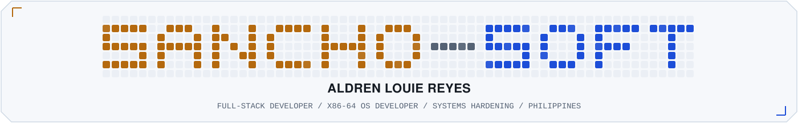
    </picture>
  </a>

  <a href="https://github.com/Sancho-soft" aria-label="GitHub profile">
    <picture>
      <source media="(prefers-color-scheme: dark)" srcset="./assets/emblem-dark.svg" />
      <source media="(prefers-color-scheme: light)" srcset="./assets/emblem-light.svg" />
      
    </picture>
  </a>

  

<!-- STATS & CONTACT PILLS -->

  
  
  
  

  
  
  
  

  <picture>
    <source media="(prefers-color-scheme: dark)" srcset="./assets/sections/splitter-dark.svg" />
    <source media="(prefers-color-scheme: light)" srcset="./assets/sections/splitter-light.svg" />
    
  </picture>

<!-- CONTENTS INDEX -->

  <a href="#about"><picture><source media="(prefers-color-scheme: dark)" srcset="./assets/sections/toc-about-dark.svg" /><source media="(prefers-color-scheme: light)" srcset="./assets/sections/toc-about-light.svg" /></picture></a>
  <a href="#skills"><picture><source media="(prefers-color-scheme: dark)" srcset="./assets/sections/toc-skills-dark.svg" /><source media="(prefers-color-scheme: light)" srcset="./assets/sections/toc-skills-light.svg" /></picture></a>
  <a href="#stats"><picture><source media="(prefers-color-scheme: dark)" srcset="./assets/sections/toc-stats-dark.svg" /><source media="(prefers-color-scheme: light)" srcset="./assets/sections/toc-stats-light.svg" /></picture></a>
  <a href="#projects"><picture><source media="(prefers-color-scheme: dark)" srcset="./assets/sections/toc-projects-dark.svg" /><source media="(prefers-color-scheme: light)" srcset="./assets/sections/toc-projects-light.svg" /></picture></a>
  <a href="#contributions"><picture><source media="(prefers-color-scheme: dark)" srcset="./assets/sections/toc-contributions-dark.svg" /><source media="(prefers-color-scheme: light)" srcset="./assets/sections/toc-contributions-light.svg" /></picture></a>
  <a href="#connect"><picture><source media="(prefers-color-scheme: dark)" srcset="./assets/sections/toc-connect-dark.svg" /><source media="(prefers-color-scheme: light)" srcset="./assets/sections/toc-connect-light.svg" /></picture></a>

<!-- ============================================================ -->
<!-- 01 · ABOUT ME                                                -->
<!-- ============================================================ -->

  <picture>
    <source media="(prefers-color-scheme: dark)" srcset="./assets/sections/about-dark.svg" />
    <source media="(prefers-color-scheme: light)" srcset="./assets/sections/about-light.svg" />
    
  </picture>

  <a href="https://github.com/Sancho-soft">
    <picture>
      <source media="(prefers-color-scheme: dark)" srcset="./assets/about-hero-dark.svg" />
      <source media="(prefers-color-scheme: light)" srcset="./assets/about-hero-light.svg" />
      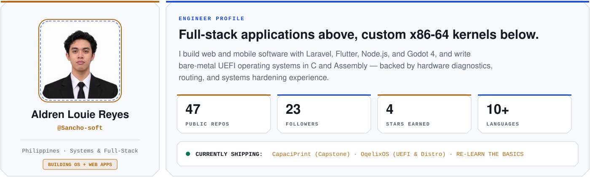
    </picture>
  </a>

  <picture>
    <source media="(prefers-color-scheme: dark)" srcset="./assets/about-code-dark.svg" />
    <source media="(prefers-color-scheme: light)" srcset="./assets/about-code-light.svg" />
    
  </picture>

  
<b>Terminal view</b>: ASCII portrait &amp; neofetch card

   
  

    <picture>
      <source media="(prefers-color-scheme: dark)" srcset="./assets/terminal-dark.svg" />
      <source media="(prefers-color-scheme: light)" srcset="./assets/terminal-light.svg" />
      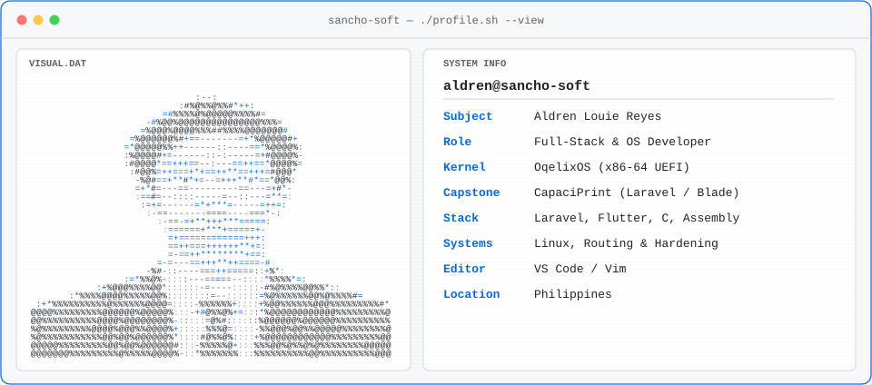
    </picture>
  

 

  <picture>
    <source media="(prefers-color-scheme: dark)" srcset="./assets/sections/splitter-dark.svg" />
    <source media="(prefers-color-scheme: light)" srcset="./assets/sections/splitter-light.svg" />
    
  </picture>

<!-- ============================================================ -->
<!-- 02 · TECH STACK                                              -->
<!-- ============================================================ -->

  <picture>
    <source media="(prefers-color-scheme: dark)" srcset="./assets/sections/skills-dark.svg" />
    <source media="(prefers-color-scheme: light)" srcset="./assets/sections/skills-light.svg" />
    
  </picture>

  <picture>
    <source media="(prefers-color-scheme: dark)" srcset="./assets/stack-flow-dark.svg" />
    <source media="(prefers-color-scheme: light)" srcset="./assets/stack-flow-light.svg" />
    
  </picture>

  <picture>
    <source media="(prefers-color-scheme: dark)" srcset="https://skillicons.dev/icons?i=c%2Ccpp%2Ccs%2Cjava%2Cpy%2Cjs%2Cphp%2Cdart%2Cr%2Crust%2Csolidity%2Chtml%2Ccss%2Cpowershell&perline=14&theme=dark" />
    <source media="(prefers-color-scheme: light)" srcset="https://skillicons.dev/icons?i=c%2Ccpp%2Ccs%2Cjava%2Cpy%2Cjs%2Cphp%2Cdart%2Cr%2Crust%2Csolidity%2Chtml%2Ccss%2Cpowershell&perline=14&theme=light" />
    
  </picture>

  <picture>
    <source media="(prefers-color-scheme: dark)" srcset="https://skillicons.dev/icons?i=laravel%2Cdotnet%2Cflutter%2Ctailwind%2Cnodejs%2Cexpress%2Cfastapi%2Cnextjs%2Cnestjs%2Cvite%2Cnpm%2Cgodot%2Cunity%2Cpostman%2Cdocker%2Carduino%2Cgit%2Cgithub%2Cvscode%2Cvim%2Cpr%2Cps%2Cae&perline=12&theme=dark" />
    <source media="(prefers-color-scheme: light)" srcset="https://skillicons.dev/icons?i=laravel%2Cdotnet%2Cflutter%2Ctailwind%2Cnodejs%2Cexpress%2Cfastapi%2Cnextjs%2Cnestjs%2Cvite%2Cnpm%2Cgodot%2Cunity%2Cpostman%2Cdocker%2Carduino%2Cgit%2Cgithub%2Cvscode%2Cvim%2Cpr%2Cps%2Cae&perline=12&theme=light" />
    
  </picture>

  <picture>
    <source media="(prefers-color-scheme: dark)" srcset="https://skillicons.dev/icons?i=aws%2Cgcp%2Ccloudflare%2Cvercel%2Cfirebase%2Csupabase%2Cpostgres%2Cmysql%2Csqlite%2Clinux%2Cbash%2Cwindows&perline=12&theme=dark" />
    <source media="(prefers-color-scheme: light)" srcset="https://skillicons.dev/icons?i=aws%2Cgcp%2Ccloudflare%2Cvercel%2Cfirebase%2Csupabase%2Cpostgres%2Cmysql%2Csqlite%2Clinux%2Cbash%2Cwindows&perline=12&theme=light" />
    
  </picture>

  
<b>Additional tech, hardware &amp; platforms</b>

   
  

    
    
    
    
    
    
    
    
    
    
    
    
    
    
    
  

 

  <picture>
    <source media="(prefers-color-scheme: dark)" srcset="./assets/sections/splitter-dark.svg" />
    <source media="(prefers-color-scheme: light)" srcset="./assets/sections/splitter-light.svg" />
    
  </picture>

<!-- ============================================================ -->
<!-- 03 · GITHUB ANALYTICS                                        -->
<!-- ============================================================ -->

  <picture>
    <source media="(prefers-color-scheme: dark)" srcset="./assets/sections/stats-dark.svg" />
    <source media="(prefers-color-scheme: light)" srcset="./assets/sections/stats-light.svg" />
    
  </picture>

  <picture>
    <source media="(prefers-color-scheme: dark)" srcset="./assets/stats-overview-dark.svg" />
    <source media="(prefers-color-scheme: light)" srcset="./assets/stats-overview-light.svg" />
    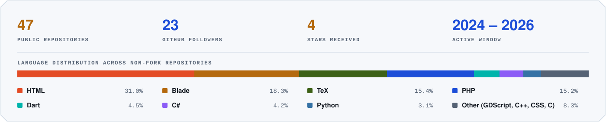
  </picture>

  
<b>Live streak &amp; commit breakdown</b>

   
  

    <a href="https://github.com/Sancho-soft">
      <picture>
        <source media="(prefers-color-scheme: dark)" srcset="https://github-profile-summary-cards.vercel.app/api/cards/stats?username=Sancho-soft&theme=github_dark" />
        <source media="(prefers-color-scheme: light)" srcset="https://github-profile-summary-cards.vercel.app/api/cards/stats?username=Sancho-soft&theme=default" />
        
      </picture>
    </a>
    &nbsp;
    <a href="https://github.com/Sancho-soft">
      <picture>
        <source media="(prefers-color-scheme: dark)" srcset="https://github-profile-summary-cards.vercel.app/api/cards/most-commit-language?username=Sancho-soft&theme=github_dark" />
        <source media="(prefers-color-scheme: light)" srcset="https://github-profile-summary-cards.vercel.app/api/cards/most-commit-language?username=Sancho-soft&theme=default" />
        
      </picture>
    </a>
      
    <a href="https://github.com/Sancho-soft">
      <picture>
        <source media="(prefers-color-scheme: dark)" srcset="https://streak-stats.demolab.com/?user=Sancho-soft&hide_border=false&border=263244&background=111722&stroke=263244&ring=E5A93C&fire=E5A93C&currStreakLabel=EDF2F7&sideLabels=8A99AD&currStreakNum=EDF2F7&sideNums=EDF2F7&dates=8A99AD" />
        <source media="(prefers-color-scheme: light)" srcset="https://streak-stats.demolab.com/?user=Sancho-soft&hide_border=false&border=CFD9E5&background=FFFFFF&stroke=CFD9E5&ring=B4690E&fire=B4690E&currStreakLabel=151B23&sideLabels=556274&currStreakNum=151B23&sideNums=151B23&dates=556274" />
        
      </picture>
    </a>
  

 

  <picture>
    <source media="(prefers-color-scheme: dark)" srcset="./assets/sections/splitter-dark.svg" />
    <source media="(prefers-color-scheme: light)" srcset="./assets/sections/splitter-light.svg" />
    
  </picture>

<!-- ============================================================ -->
<!-- 04 · FEATURED PROJECTS                                       -->
<!-- ============================================================ -->

  <picture>
    <source media="(prefers-color-scheme: dark)" srcset="./assets/sections/projects-dark.svg" />
    <source media="(prefers-color-scheme: light)" srcset="./assets/sections/projects-light.svg" />
    
  </picture>

<!-- Spotlight -->

  <a href="https://github.com/Sancho-soft/OqelixOS---Operating-System-using-AI-for-testing-V1">
    <picture>
      <source media="(prefers-color-scheme: dark)" srcset="./assets/projects/spotlight-oqelixos-dark.svg" />
      <source media="(prefers-color-scheme: light)" srcset="./assets/projects/spotlight-oqelixos-light.svg" />
      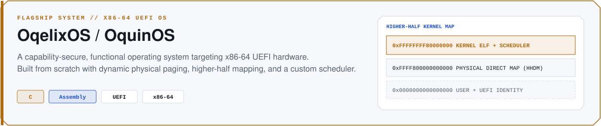
    </picture>
  </a>

<!-- 2-Column Featured Grid -->

  <a href="https://github.com/Sancho-soft/CAPACIPRINT-DEVELOPMENT-SYSTEM"><picture><source media="(prefers-color-scheme: dark)" srcset="./assets/projects/capaciprint-dark.svg" /><source media="(prefers-color-scheme: light)" srcset="./assets/projects/capaciprint-light.svg" />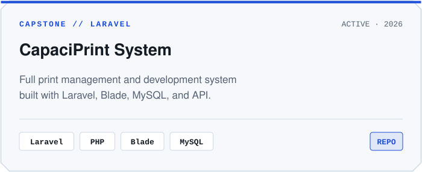</picture></a>
  <a href="https://github.com/Sancho-soft/MAIKCORD---A-Alternative-Inspired-Teamspeak-Discord-Application"><picture><source media="(prefers-color-scheme: dark)" srcset="./assets/projects/maikcord-dark.svg" /><source media="(prefers-color-scheme: light)" srcset="./assets/projects/maikcord-light.svg" />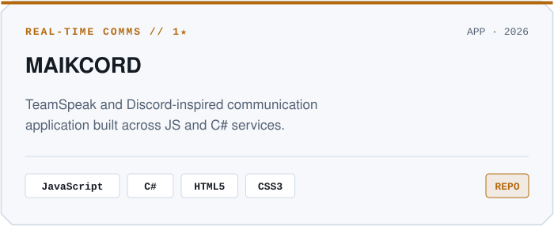</picture></a>

  <a href="https://github.com/Sancho-soft/OqelixOS-Linux-Distribution-Development"><picture><source media="(prefers-color-scheme: dark)" srcset="./assets/projects/oqelix-linux-dark.svg" /><source media="(prefers-color-scheme: light)" srcset="./assets/projects/oqelix-linux-light.svg" />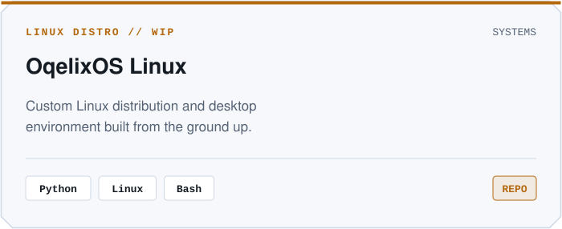</picture></a>
  <a href="https://github.com/Sancho-soft/Keitask---Student-Progress-Tracker"><picture><source media="(prefers-color-scheme: dark)" srcset="./assets/projects/keitask-dark.svg" /><source media="(prefers-color-scheme: light)" srcset="./assets/projects/keitask-light.svg" />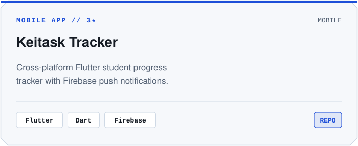</picture></a>

  <a href="https://github.com/Sancho-soft/RE-LEARN-THE-BASICS"><picture><source media="(prefers-color-scheme: dark)" srcset="./assets/projects/relearn-dark.svg" /><source media="(prefers-color-scheme: light)" srcset="./assets/projects/relearn-light.svg" />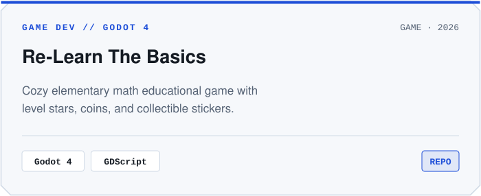</picture></a>
  <a href="https://github.com/Sancho-soft/3D-PORTFOLIO-WEBSITE"><picture><source media="(prefers-color-scheme: dark)" srcset="./assets/projects/portfolio3d-dark.svg" /><source media="(prefers-color-scheme: light)" srcset="./assets/projects/portfolio3d-light.svg" />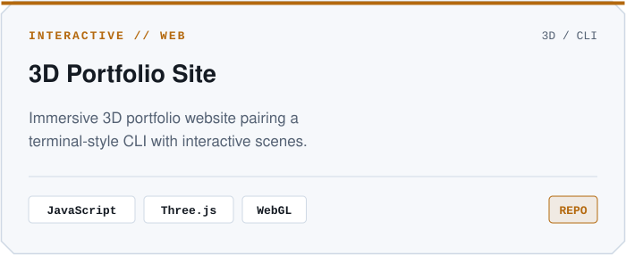</picture></a>

<b>Project index</b>: additional &amp; earlier repositories, grouped by area

 

<table width="100%">
<tr><th align="left" colspan="2">Mobile &amp; Safety</th></tr>
<tr><td><a href="https://github.com/Sancho-soft/SENTINEL---EIRS"><b>SENTINEL — EIRS</b></a></td><td>Smart Incident Reporting &amp; Response System (Flutter / Dart)</td></tr>
<tr><th align="left" colspan="2">Full-Stack &amp; Web Systems</th></tr>
<tr><td><a href="https://github.com/Sancho-soft/API-FOR-CAPACIPRINT----DOCUMENTARY-AND-TESTING"><b>API for CapaciPrint</b></a></td><td>Companion API documentation &amp; testing repository for CapaciPrint</td></tr>
<tr><td><a href="https://github.com/Sancho-soft/IT12---REPAIR-SYSTEM-REVISED"><b>IT12 — Repair System Revised</b></a></td><td>Hardware &amp; repair tracking system (PHP / Laravel)</td></tr>
<tr><td><a href="https://github.com/Sancho-soft/MAWASA---Water-Billing-System"><b>MAWASA — Water Billing System</b></a></td><td>Water utility billing web application (Laravel / Blade)</td></tr>
<tr><td><a href="https://github.com/Sancho-soft/SHS-Enrollment-System---NextGen-Full-system-Integration"><b>SHS Enrollment System</b></a></td><td>Full-system enrollment integration (Laravel / Blade)</td></tr>
<tr><td><a href="https://github.com/Sancho-soft/IT-15-ClientSphere-System-CRM"><b>ClientSphere CRM System</b></a></td><td>Multi-iteration customer relationship management system</td></tr>
<tr><th align="left" colspan="2">Python &amp; Prototypes</th></tr>
<tr><td><a href="https://github.com/Sancho-soft/STAYEASE-Hotel-Management"><b>STAYEASE Hotel Management</b></a></td><td>Hotel management application in Python</td></tr>
<tr><td><a href="https://github.com/Sancho-soft/-PROTOTYPE-Carivio-Random-Forest-Based-Career-Pathway-Support-Needs-Prediction-System-CANCELLED"><b>Carivio (Discontinued)</b></a></td><td>Random Forest career pathway &amp; support needs prototype</td></tr>
</table>

 

  <picture>
    <source media="(prefers-color-scheme: dark)" srcset="./assets/sections/splitter-dark.svg" />
    <source media="(prefers-color-scheme: light)" srcset="./assets/sections/splitter-light.svg" />
    
  </picture>

<!-- ============================================================ -->
<!-- 05 · CONTRIBUTION GRAPH                                      -->
<!-- ============================================================ -->

  <picture>
    <source media="(prefers-color-scheme: dark)" srcset="./assets/sections/contributions-dark.svg" />
    <source media="(prefers-color-scheme: light)" srcset="./assets/sections/contributions-light.svg" />
    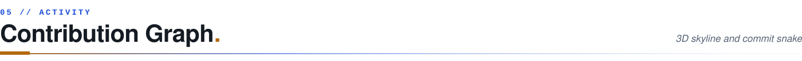
  </picture>

  <picture>
    <source media="(prefers-color-scheme: dark)" srcset="./profile-3d-contrib/profile-night-view.svg" />
    <source media="(prefers-color-scheme: light)" srcset="./profile-3d-contrib/profile-season.svg" />
    
  </picture>

    

  <picture>
    <source media="(prefers-color-scheme: dark)" srcset="https://raw.githubusercontent.com/Sancho-soft/Sancho-soft/output/github-snake-dark.svg" />
    <source media="(prefers-color-scheme: light)" srcset="https://raw.githubusercontent.com/Sancho-soft/Sancho-soft/output/github-snake.svg" />
    
  </picture>

 

  <picture>
    <source media="(prefers-color-scheme: dark)" srcset="./assets/sections/splitter-dark.svg" />
    <source media="(prefers-color-scheme: light)" srcset="./assets/sections/splitter-light.svg" />
    
  </picture>

<!-- ============================================================ -->
<!-- 06 · CONNECT WITH ME                                         -->
<!-- ============================================================ -->

  <picture>
    <source media="(prefers-color-scheme: dark)" srcset="./assets/sections/connect-dark.svg" />
    <source media="(prefers-color-scheme: light)" srcset="./assets/sections/connect-light.svg" />
    
  </picture>

  <a href="mailto:reyesaldrenlouie@gmail.com"><picture><source media="(prefers-color-scheme: dark)" srcset="./assets/connect/email-dark.svg" /><source media="(prefers-color-scheme: light)" srcset="./assets/connect/email-light.svg" />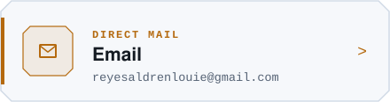</picture></a>
  <a href="https://x.com/aldren_louie"><picture><source media="(prefers-color-scheme: dark)" srcset="./assets/connect/x-dark.svg" /><source media="(prefers-color-scheme: light)" srcset="./assets/connect/x-light.svg" />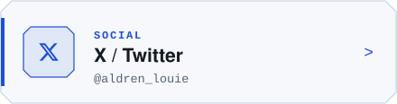</picture></a>

  <a href="https://github.com/Sancho-soft"><picture><source media="(prefers-color-scheme: dark)" srcset="./assets/connect/github-dark.svg" /><source media="(prefers-color-scheme: light)" srcset="./assets/connect/github-light.svg" /></picture></a>
  <a href="https://www.facebook.com/aldrenlouie.reyes"><picture><source media="(prefers-color-scheme: dark)" srcset="./assets/connect/facebook-dark.svg" /><source media="(prefers-color-scheme: light)" srcset="./assets/connect/facebook-light.svg" /></picture></a>

 

  <a href="#top">
    <picture>
      <source media="(prefers-color-scheme: dark)" srcset="./assets/connect/footer-dark.svg" />
      <source media="(prefers-color-scheme: light)" srcset="./assets/connect/footer-light.svg" />
      
    </picture>
  </a>

