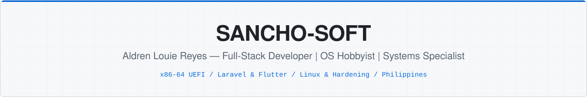

<picture>
  <source media="(prefers-color-scheme: dark)" srcset="assets/banner-dark.svg" />
  <source media="(prefers-color-scheme: light)" srcset="assets/banner-light.svg" />
  
</picture>

 

&nbsp;

&nbsp;

---

<h2> About Me</h2>

I'm **Aldren Louie Reyes** (`Sancho-Soft`), a full-stack developer based in the **Philippines** who builds operating systems on the side. I write web and mobile applications with **Laravel** and **Flutter**, and bare-metal **x86-64** code in **C**, **Assembly**, and **UEFI**, backed by hands-on experience in hardware diagnostics, routing, and systems hardening.

- **Role:** Full-Stack Developer & OS Hobbyist
- **OS Dev:** OqelixOS / OquinOS (`x86-64` / `UEFI`)
- **Capstone:** CapaciPrint Development System (`Laravel` / `Blade`)
- **In Progress:** OqelixOS Linux Distribution & 3D Portfolio Website
- **Editor:** VS Code / Vim
- **Hardware:** Diagnostics, Routing & Systems Hardening

 

---

<h2> Tech Stack</h2>

<h3> Languages &amp; Bare Metal</h3>

  <picture>
    <source media="(prefers-color-scheme: dark)" srcset="https://skillicons.dev/icons?i=c%2Ccpp%2Cpy%2Cphp%2Ccs%2Cdart%2Cjs%2Chtml%2Ccss&theme=dark" />
    <source media="(prefers-color-scheme: light)" srcset="https://skillicons.dev/icons?i=c%2Ccpp%2Cpy%2Cphp%2Ccs%2Cdart%2Cjs%2Chtml%2Ccss&theme=light" />
    
  </picture>

<h3> Frameworks, Libraries &amp; Tools</h3>

  <picture>
    <source media="(prefers-color-scheme: dark)" srcset="https://skillicons.dev/icons?i=flutter%2Claravel%2Cdotnet%2Ctailwind%2Cdocker%2Carduino%2Cgit%2Cgithub%2Cvscode%2Cvim&theme=dark" />
    <source media="(prefers-color-scheme: light)" srcset="https://skillicons.dev/icons?i=flutter%2Claravel%2Cdotnet%2Ctailwind%2Cdocker%2Carduino%2Cgit%2Cgithub%2Cvscode%2Cvim&theme=light" />
    
  </picture>

<h3> Databases &amp; Platforms</h3>

  <picture>
    <source media="(prefers-color-scheme: dark)" srcset="https://skillicons.dev/icons?i=mysql%2Csqlite%2Clinux%2Cbash&theme=dark" />
    <source media="(prefers-color-scheme: light)" srcset="https://skillicons.dev/icons?i=mysql%2Csqlite%2Clinux%2Cbash&theme=light" />
    
  </picture>

---

<h2> GitHub Analytics</h2>

<a href="https://github.com/Sancho-soft">
  <picture>
    <source media="(prefers-color-scheme: dark)" srcset="https://github-profile-summary-cards.vercel.app/api/cards/stats?username=Sancho-soft&theme=github_dark" />
    <source media="(prefers-color-scheme: light)" srcset="https://github-profile-summary-cards.vercel.app/api/cards/stats?username=Sancho-soft&theme=default" />
    
  </picture>
</a>
&nbsp;
<a href="https://github.com/Sancho-soft">
  <picture>
    <source media="(prefers-color-scheme: dark)" srcset="https://github-profile-summary-cards.vercel.app/api/cards/repos-per-language?username=Sancho-soft&theme=github_dark" />
    <source media="(prefers-color-scheme: light)" srcset="https://github-profile-summary-cards.vercel.app/api/cards/repos-per-language?username=Sancho-soft&theme=default" />
    
  </picture>
</a>
&nbsp;
<a href="https://github.com/Sancho-soft">
  <picture>
    <source media="(prefers-color-scheme: dark)" srcset="https://github-profile-summary-cards.vercel.app/api/cards/most-commit-language?username=Sancho-soft&theme=github_dark" />
    <source media="(prefers-color-scheme: light)" srcset="https://github-profile-summary-cards.vercel.app/api/cards/most-commit-language?username=Sancho-soft&theme=default" />
    
  </picture>
</a>

  

<a href="https://github.com/Sancho-soft">
  <picture>
    <source media="(prefers-color-scheme: dark)" srcset="https://streak-stats.demolab.com/?user=Sancho-soft&hide_border=false&border=30363d&background=0d1117&stroke=30363d&ring=58a6ff&fire=58a6ff&currStreakLabel=e6edf3&sideLabels=8b949e&currStreakNum=e6edf3&sideNums=e6edf3&dates=8b949e" />
    <source media="(prefers-color-scheme: light)" srcset="https://streak-stats.demolab.com/?user=Sancho-soft&hide_border=false&border=d0d7de&background=ffffff&stroke=d0d7de&ring=0969da&fire=0969da&currStreakLabel=1f2328&sideLabels=59636e&currStreakNum=1f2328&sideNums=1f2328&dates=59636e" />
    
  </picture>
</a>

  

<a href="https://github.com/Sancho-soft">
  <picture>
    <source media="(prefers-color-scheme: dark)" srcset="https://github-profile-summary-cards.vercel.app/api/cards/profile-details?username=Sancho-soft&theme=github_dark" />
    <source media="(prefers-color-scheme: light)" srcset="https://github-profile-summary-cards.vercel.app/api/cards/profile-details?username=Sancho-soft&theme=default" />
    
  </picture>
</a>

---

<h2> Highlights</h2>

  
  &nbsp;
  
  &nbsp;
  
  &nbsp;
  
  &nbsp;
  

---

<h2> Featured Projects</h2>

<table>
<tr>
<td width="50%" valign="top">

<h3> <a href="https://github.com/Sancho-soft/OqelixOS---Operating-System-using-AI-for-testing-V1">OqelixOS / OquinOS</a></h3>

A capability-secure, functional operating system targeting x86-64 UEFI hardware. Built from scratch with dynamic physical paging, higher-half mapping, and a custom scheduler.

  
  
  
  

</td>
<td width="50%" valign="top">

<h3> <a href="https://github.com/Sancho-soft/CAPACIPRINT-DEVELOPMENT-SYSTEM">CapaciPrint Development System</a></h3>

Capstone project — a comprehensive print management and development system built with Laravel and the Blade templating engine.

  
  
  
  

</td>
</tr>
<tr>
<td width="50%" valign="top">

<h3> <a href="https://github.com/Sancho-soft/OqelixOS-Linux-Distribution-Development-v1.0">OqelixOS Linux Distribution</a></h3>

Custom Linux distribution development — building a fully customized desktop environment from the ground up.

  
  
  
  

</td>
<td width="50%" valign="top">

<h3> <a href="https://github.com/Sancho-soft/3D-PORTFOLIO-WEBSITE">3D Portfolio Website</a></h3>

An immersive 3D portfolio website with a terminal-style CLI interface and interactive animations.

  
  
  
  

</td>
</tr>
<tr>
<td width="50%" valign="top">

<h3> <a href="https://github.com/Sancho-soft/IT-15-ClientSphere-System-CRM">ClientSphere CRM System</a></h3>

A customer relationship management system with multi-iteration improvements across academic projects.

  
  
  

</td>
<td width="50%" valign="top">

<h3> <a href="https://github.com/Sancho-soft/-PROTOTYPE-Carivio-Random-Forest-Based-Career-Pathway-Support-Needs-Prediction-System-CANCELLED">Carivio - Career Prediction System</a></h3>

Random Forest-based career pathway and support needs prediction system prototype (discontinued).

  
  
  

</td>
</tr>
</table>

---

<h2> Connect With Me</h2>

 

&nbsp;

&nbsp;

&nbsp;

&nbsp;

  

---

<h2> Contribution Activity</h2>

  <picture>
    <source media="(prefers-color-scheme: dark)" srcset="https://raw.githubusercontent.com/Sancho-soft/Sancho-soft/output/github-snake-dark.svg" />
    <source media="(prefers-color-scheme: light)" srcset="https://raw.githubusercontent.com/Sancho-soft/Sancho-soft/output/github-snake.svg" />
    
  </picture>

 

  Aldren Louie Reyes · Sancho-Soft · Philippines

